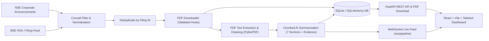

# Finosauras Intelligence

**AI-Powered Indian Earnings Call Analytics Platform (NSE & BSE)**

Finosauras Intelligence monitors corporate announcements from **NSE** and **BSE**, identifies earnings-call / conference-call filings, extracts transcript PDFs, generates structured 7-section AI summaries with source evidence quotes, and streams live pipeline updates to a modern React dashboard.

---

## Full Workflow



---

## How It Works (Step-by-Step)

1. **Exchange Ingestion (`backend/app/ingestion/`)**
   - **`nse.py`**: Fetches recent equity corporate announcements from NSE's public announcement endpoint.
   - **`bse.py`**: Reads BSE's latest corporate announcements RSS feed (`announcements.xml`) and API fallback.
   - **`watcher.py`**: Combines announcements from both exchanges, filters for concall/transcript filings using `KEYWORDS`, extracts quarter labels (e.g., `Q3 FY26`), normalizes metadata, and deduplicates by `filing_id`.
   - **`downloader.py`**: Validates attachment hostnames against `ALLOWED_HOSTS`, verifies `%PDF-` headers and size limits, and saves PDFs to `data/transcripts/`.

2. **Database & Storage (`backend/app/database.py`, `backend/app/models/transcript.py`)**
   - Stores each transcript's company, symbol, exchange, filing ID, quarter, call date, PDF path, extracted `raw_text`, structured `summary_json`, and `summary_markdown` in SQLite (`finosauras.db`).
   - **`backend/app/seed.py`**: Generates sample transcript PDFs via PyMuPDF and seeds all 7 tracked companies so the platform can be explored and tested immediately.

3. **Backend API & Real-Time WebSocket (`backend/app/api/`)**
   - **`routes.py`**: Exposes REST endpoints for tracked companies, dashboard KPIs, transcript listings, full 7-section AI summaries, and direct PDF downloads (`FileResponse`).
   - **`websocket.py`**: Manages active WebSocket connections on `/ws/pipeline` and broadcasts live pipeline events to the frontend.

4. **Frontend Dashboard (`frontend/src/`)**
   - Built with **React**, **Vite**, **Tailwind CSS**, **Recharts**, **React Router**, and **Axios**.
   - Vite proxies `/api` to `http://127.0.0.1:8000` and `/ws` to `ws://127.0.0.1:8000`.
   - Displays tracked companies, transcript coverage charts, live WebSocket status, 7-section AI summaries with transcript evidence quotes, raw transcript viewer, and one-click PDF downloads.

---

## Tracked Companies

| Company | NSE Symbol | BSE Scrip Code |
|---|---|---|
| TCS | `TCS` | `532540` |
| Infosys | `INFY` | `500209` |
| HDFC Bank | `HDFCBANK` | `500180` |
| ICICI Bank | `ICICIBANK` | `532174` |
| Reliance Industries | `RELIANCE` | `500325` |
| Tata Motors | `TATAMOTORS` | `500570` |
| Sun Pharma | `SUNPHARMA` | `524715` |

---

## Project Structure

```text
AI cell/
├── backend/
│   ├── app/
│   │   ├── api/            # FastAPI routes & WebSocket manager
│   │   ├── extraction/     # PDF text extraction, OCR, cleaning
│   │   ├── ingestion/      # NSE/BSE collectors, watcher, downloader, tests
│   │   ├── models/         # SQLAlchemy Transcript model
│   │   ├── schemas/        # Pydantic schemas for AI summaries
│   │   ├── summarization/  # LLM, chunking, prompts
│   │   ├── config.py       # Paths, env vars, tracked companies
│   │   ├── database.py     # SQLite engine & session setup
│   │   ├── main.py         # FastAPI app & CORS config
│   │   └── seed.py         # Sample dataset + PDF generator
│   ├── requirements.txt
│   └── .env.example
├── frontend/
│   ├── src/
│   │   ├── components/     # Navbar, Sidebar, CompanyCard, SummaryCard, LiveFeed
│   │   ├── pages/          # Dashboard, CompanyDetails, TranscriptDetails
│   │   ├── services/       # Axios API client & WebSocket client
│   │   ├── App.jsx
│   │   └── main.jsx
│   ├── package.json
│   └── vite.config.js      # Vite dev server + /api & /ws proxy
├── data/
│   ├── transcripts/        # Downloaded / generated transcript PDFs
│   └── summaries/          # Generated Markdown summaries
├── samples/                # Sample company workspace folders
├── .env.example
├── .gitignore
├── README.md
└── run.py                  # Quick backend launcher
```

---

## Setup & Running Locally

### 1. Environment Variables
Copy `.env.example` to `.env` in the project root and set your key if using live AI summarization:
```env
GEMINI_API_KEY=your_api_key_here
DATABASE_URL=
```
*(Leave `DATABASE_URL=` blank to use the default local SQLite database `finosauras.db`.)*

### 2. Backend Setup & Seed Data
```powershell
# Activate your Python virtual environment if not active
.\.venv\Scripts\Activate.ps1

# Install Python dependencies
pip install -r backend\requirements.txt

# Seed sample transcripts & PDFs for all 7 companies
$env:PYTHONPATH="backend"
python -m app.seed

# Start FastAPI server (http://127.0.0.1:8000)
uvicorn app.main:app --app-dir backend --host 127.0.0.1 --port 8000 --reload
```

### 3. Frontend Setup
Open a second terminal:
```powershell
cd frontend
npm install
npm run dev
```
Open **http://127.0.0.1:5173/** in your browser.

### 4. Test Live NSE/BSE Ingestion
```powershell
$env:PYTHONPATH="backend"
python -m app.ingestion.test_sources
```

---

## API Endpoints

| Method | Endpoint | Description |
|---|---|---|
| `GET` | `/api/health` | Service health check |
| `GET` | `/api/companies` | List all 7 tracked companies |
| `GET` | `/api/stats` | Dashboard KPI counts & pipeline status |
| `GET` | `/api/transcripts` | List ingested transcripts (optional `?company=SYMBOL`) |
| `GET` | `/api/transcripts/{id}` | Full transcript details, 7-section AI summary & raw text |
| `GET` | `/api/transcripts/{id}/pdf` | Download the transcript PDF file |
| `WS` | `/ws/pipeline` | Real-time WebSocket feed for pipeline events |
| `GET` | `/docs` | Interactive Swagger API documentation |

---

## Known Limitations

- **Undocumented Exchange Endpoints:** NSE's public announcement endpoint (`/api/corporate-announcements`) is not a guaranteed public developer API; root requests (`https://www.nseindia.com/`) can return `403 Forbidden` or redirect to `nseindia.in`, and attachment hosts may change (`nsearchives.nseindia.in` vs `.com`).
- **BSE RSS Feed Scope:** BSE's `announcements.xml` feed only exposes the latest announcements rather than a complete historical archive, and some item links point to HTML pages instead of direct PDF files.
- **Keyword Filtering Precision:** First-pass keyword matching can include analyst-meet invitations or presentations alongside actual earnings-call transcripts until stricter category/title rules are applied.
- **PDF & OCR Constraints:** Scanned image-only PDFs require an OCR fallback, and very large transcripts must be chunked to fit LLM context limits.
- **Sample vs. Live AI Mode:** Without a `GEMINI_API_KEY` in `.env`, the platform serves seeded sample datasets (`backend/app/seed.py`) rather than live Gemini-generated summaries.


